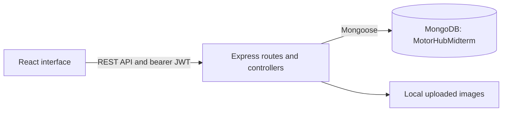
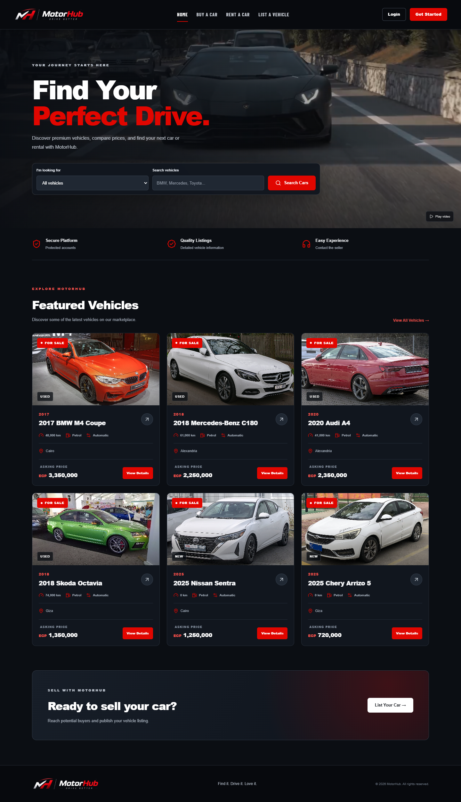
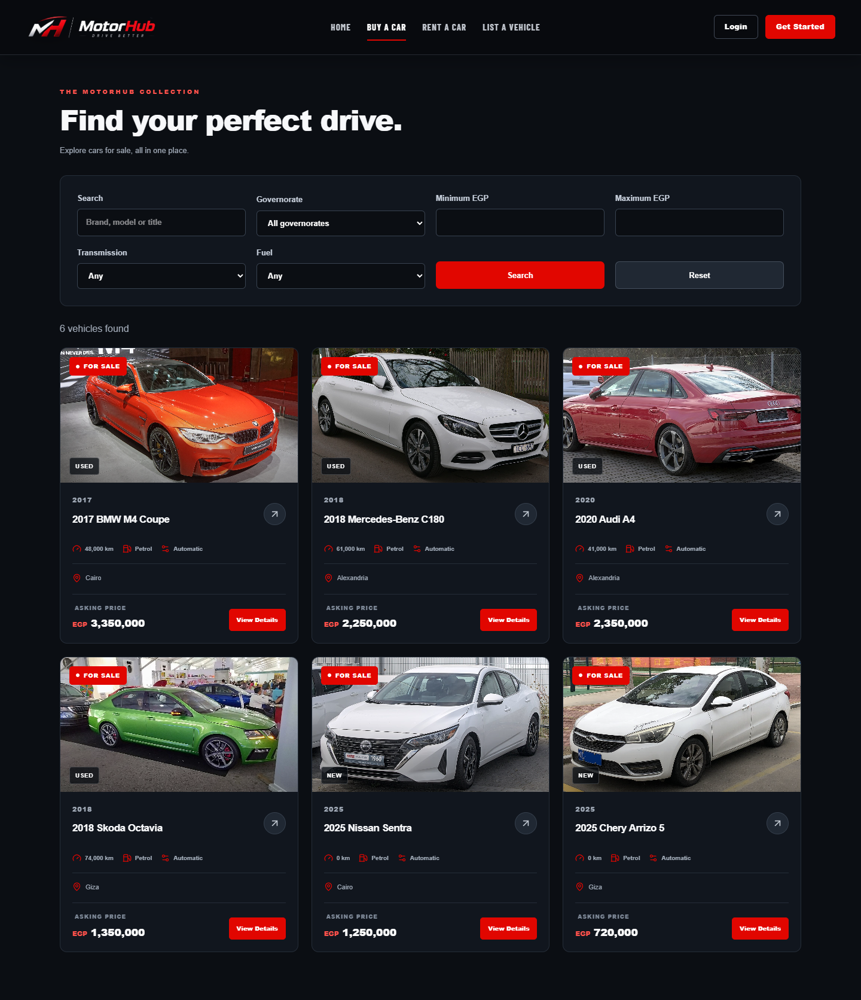
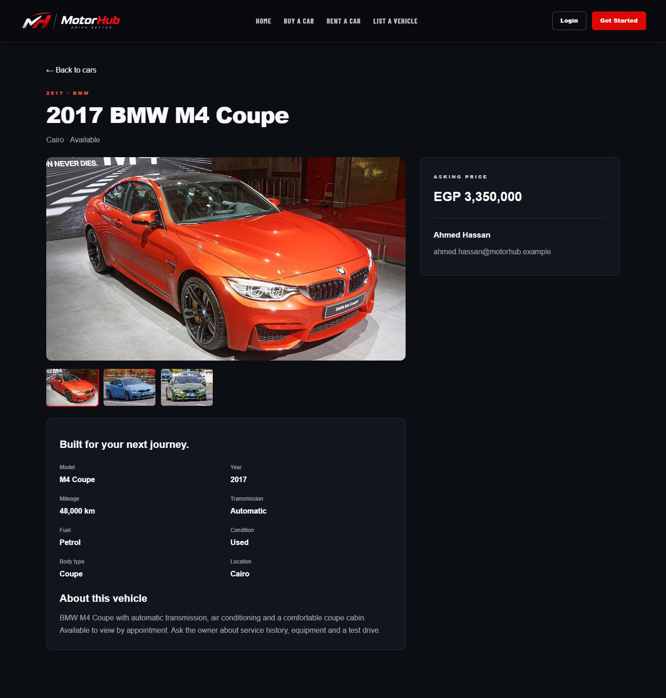
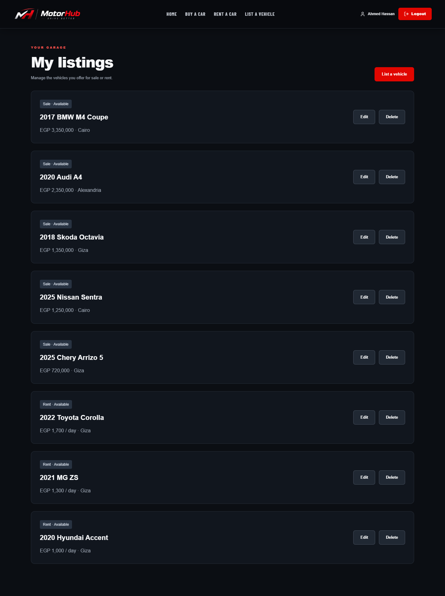

# MotorHub — midterm

A React, Express and MongoDB vehicle marketplace. Browse cars for sale or rent, search and filter listings, view photographs, contact an owner, and publish/manage your own vehicles. This submission focuses on the marketplace foundation.

## Run

Requires Node.js 22.12+ and MongoDB Atlas or a configured MongoDB replica set. Listing updates/deletion use transactions. Both apps use ports 5000 and 5173: stop the full project before starting this midterm copy.

For a fresh extracted copy:

```powershell
npm run install:all
Copy-Item backend/.env.example backend/.env
Copy-Item frontend/.env.example frontend/.env
node -e "console.log(require('crypto').randomBytes(48).toString('hex'))"
```

Preserve existing environment files on an already configured installation. In private backend/.env, set MONGO_URI to a separate **MotorHubMidterm** database, set JWT_SECRET to your own random value, and set DEMO_PASSWORD to at least eight characters for the two prepared owners. Keep VITE_API_URL=/api. Credentials are never included in source or documentation.

```powershell
# Once, or to safely add missing prepared records
npm run seed:demo

# Terminal 1
npm run backend

# Terminal 2
npm run frontend
```

Open http://localhost:5173. The normal frontend command uses the full project's build-and-preview startup on fixed port 5173, with API/upload proxying. For hot-reload editing, stop it and use npm run frontend:dev. After source edits, restart npm run frontend to rebuild. To share the interface, forward 5173 while keeping both servers running.

## Included features

- Registration, login/logout, session restoration and protected listing pages.
- Sale and rental browsing; text search, governorate dropdowns, price, transmission and fuel filters.
- Vehicle details, a selectable photo gallery, seller contact links and New/Used condition.
- Authenticated image uploads and owner-only create/edit/delete through My listings.
- The full project's existing driving video, Pause/Play control, reduced-motion/data-saving fallback, real MotorHub logo and locally served original font.
- Twelve prepared listings and two named owner accounts, reused from the full project. No admin account is created.

Rentals are advertised listings: contact the owner to discuss dates. Online booking workflows, favorites, checkout/payments, notifications and an admin interface are outside this midterm submission.

Navigation reuses the full project’s short page transitions, subtle card/button hover effects, scroll restoration and reduced-motion handling. Unsupported browsers keep ordinary navigation; no extra loading screen or artificial delay is introduced.

## Prepared accounts and inventory

| Account      | Email                         | Password          |
| ------------ | ----------------------------- | ----------------- |
| Ahmed Hassan | ahmed.hassan@motorhub.example | see DEMO_PASSWORD |
| Mohamed Adel | mohamed.adel@motorhub.example | see DEMO_PASSWORD |

These fictional owners and all twelve cars come from the full MotorHub project. The seed preserves its existing records, listing edits, passwords and unrelated accounts when repeated. It uses fixed IDs and ownership keys, refuses conflicting identities, and refuses to seed a database without “Midterm” in its name. The midterm and full project therefore remain separate databases.

| Car                      | Listing | Condition | Photos |
| ------------------------ | ------- | --------- | -----: |
| 2017 BMW M4 Coupe        | Sale    | Used      |      3 |
| 2018 Mercedes-Benz C180  | Sale    | Used      |      3 |
| 2020 Audi A4             | Sale    | Used      |      3 |
| 2018 Skoda Octavia       | Sale    | Used      |      3 |
| 2025 Nissan Sentra       | Sale    | New       |      3 |
| 2025 Chery Arrizo 5      | Sale    | New       |      3 |
| 2022 Toyota Corolla      | Rent    | New       |      3 |
| 2022 Hyundai Elantra CN7 | Rent    | New       |      3 |
| 2021 Nissan Sunny        | Rent    | Used      |      3 |
| 2021 MG ZS               | Rent    | Used      |      3 |
| 2009 Chevrolet Optra     | Rent    | Used      |      3 |
| 2020 Hyundai Accent      | Rent    | Used      |      3 |

There are six Sale and six Rent listings, including two zero-mileage New cars for Sale and two for Rent. Every listing has three local photographs. Prices/specifications are fictional project examples; stock images illustrate the model. Credits are in PHOTO_CREDITS.md.

## Architecture



The listing form and Buy/Rent filters reuse the full project’s shared 27-governorate list. Existing city names such as New Cairo and Sheikh Zayed map to Cairo and Giza when filtering or editing. The server validates new location values using the same shared data.

React renders the screens and submits form/search requests. Express validates input, authenticates users, checks listing ownership and returns JSON. Mongoose reads/writes the User and Vehicle collections. Passwords are hashed with bcrypt; bearer tokens are kept in localStorage in this midterm version. Uploads are stored under backend/uploads and need persistent storage when hosted.

## Screenshots and layouts

Screenshots were taken from the updated midterm with an isolated test database.









## Five-minute instructor walkthrough

1. Open Home: show the matching red/dark palette, actual logo and driving video. Pause and resume the video.
2. Open Buy a Car and Rent a Car: show the populated grids, search for Corolla or Sentra, apply a price/location filter, then Reset.
3. Open a vehicle: switch between its three photos, show specifications, New/Used condition and owner contact links.
4. Sign in as Ahmed Hassan using DEMO_PASSWORD. Open My listings and show his vehicles. Sign out.
5. Register your own account. Open List a Vehicle, upload a photo and publish a listing. Confirm it appears in My listings and search results.
6. Edit its title/price; delete it using the confirmation button. Sign out and open /sell to show the sign-in requirement.

## Verification

```powershell
npm test
npm run build
```

The backend tests use a disposable MongoDB replica set, not the configured Atlas database. They check registration/login, authentication, listing CRUD and ownership, filtering, repeatable seeding, missing-password safety, preserved existing data, local photo assets and editing a prepared listing without losing its photos. Booking/favorite routes are deliberately absent.

The updated midterm is also checked in Chrome through register → photo upload → create → search/reset → edit → delete → logout, plus protected routes, the video pause control, reduced-motion behavior and 390-pixel mobile layouts. These checks do not imply a grading percentage or production deployment certification.

## Rubric coverage

| Criterion                        | Evidence                                                                                       |
| -------------------------------- | ---------------------------------------------------------------------------------------------- |
| Matching colors; clean/simple UI | Consistent MotorHub design, small navigation and clear forms                                   |
| Images and videos                | Three photos per prepared car, uploaded photos and the reused driving video                    |
| Navigation links and layouts     | Home sections, browse grids, split details, authentication cards, listing form and My listings |
| React frontend                   | frontend/src pages, components and AuthContext                                                 |
| Express server                   | backend/app.js, controllers and routes                                                         |
| MongoDB database                 | User/Vehicle models, persisted CRUD and isolated integration tests                             |
| Simple documentation             | This README, architecture diagram, walkthrough and four screenshots                            |
| Extra content                    | Authentication, protected pages, filters, photo uploads and ownership enforcement              |
